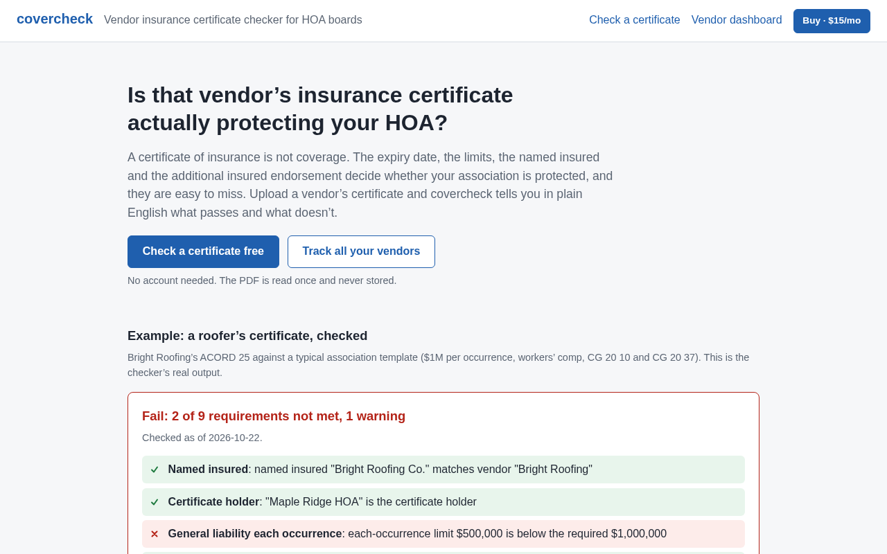
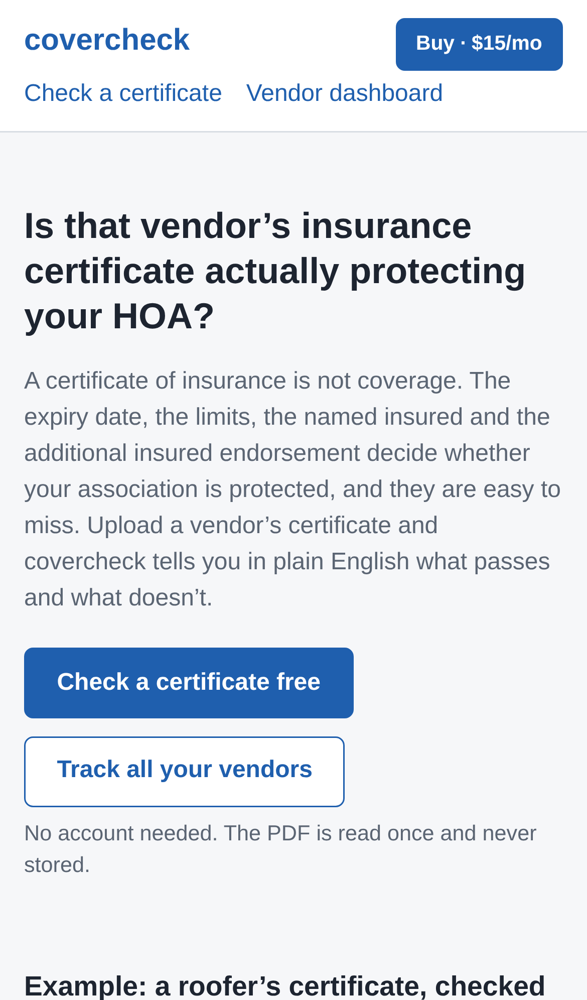
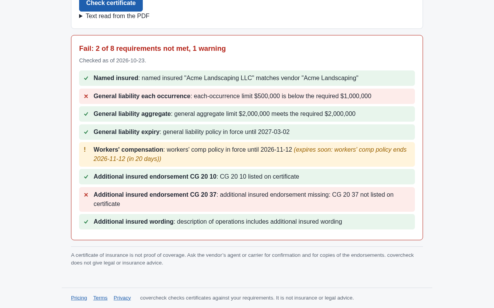
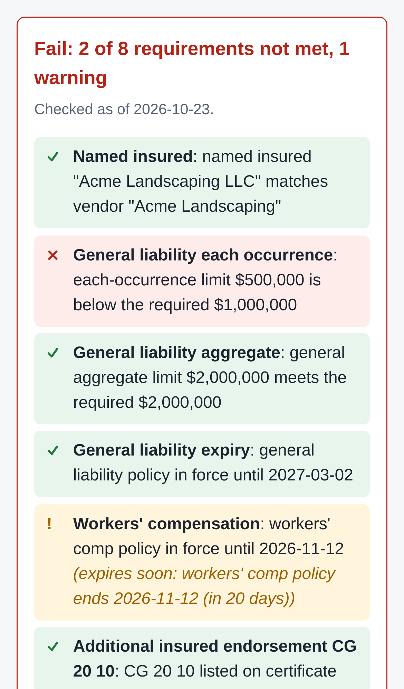
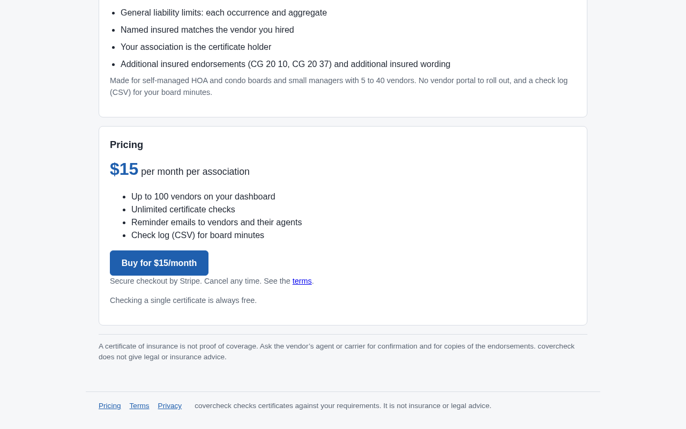
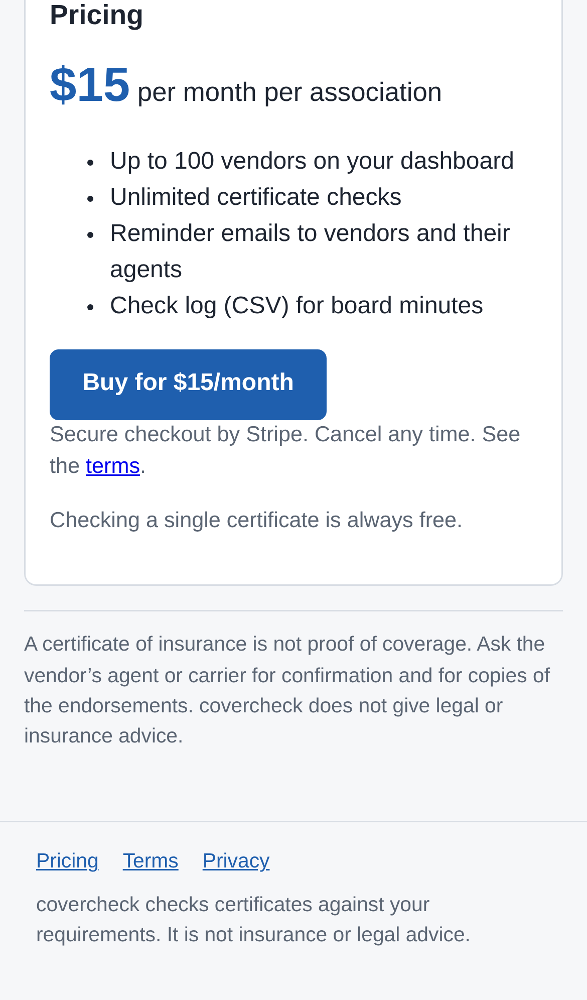

# covercheck — vendor insurance certificate checker for HOA boards

## Screenshots

Captured by `npm run screenshots` from the production build, with sample data only and a placeholder payment link (`https://example.com/pay`).

The landing page leads with "Check a certificate free" and a sample verdict from the real rules; the header's Buy · $15/mo button appears because a payment link is set.

The same page on an iPhone 13: the brand and the Buy button share the top row, and the call to action stays above the fold.

The core action: a sample ACORD 25 PDF uploaded on `/check` is read and checked; the $500,000 limit and the missing CG 20 37 fail with plain-English reasons, and workers' comp gets an "expires soon" warning.

The same verdict on a phone, one requirement per line.

The bottom of the landing page: $15 per month per association with the Buy button, and the footer's Pricing, Terms and Privacy links.

The same pricing section and footer links on a phone.

For self-managed HOA and condo boards and small property managers, it checks each vendor's insurance certificate for the endorsement, name and expiry that actually protect the association, and nudges vendors before coverage lapses, at a board-sized price instead of $99+/month.

- [Research](RESEARCH.md) — findings and sources
- [PRD](PRD.md)
- [Roadmap](ROADMAP.md)
- [Build notes](BUILD.md): what's built, how to run, test and deploy it
- [Launch notes](LAUNCH-READY.md): search and sharing tags, legal pages, Buy button, visit beacon, and what's left before launch

Effort: Medium · Confidence: Low

_Researched by the idea pipeline on 2026-10-11 ([original record](https://github.com/smithdavedesign/idea-factory/tree/main/ideas/covercheck)); repo created on David's go-ahead 2026-10-11._
