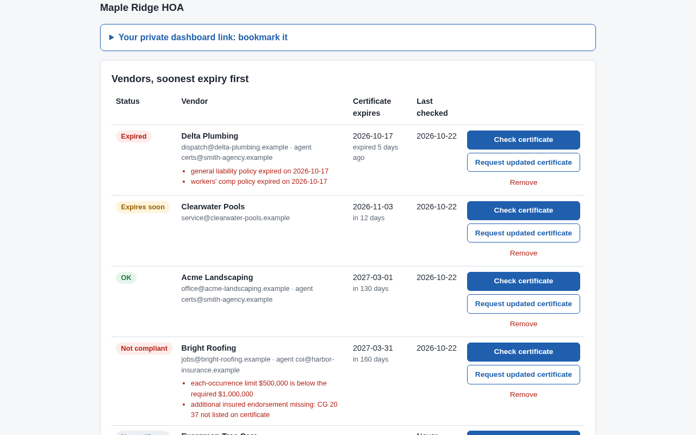
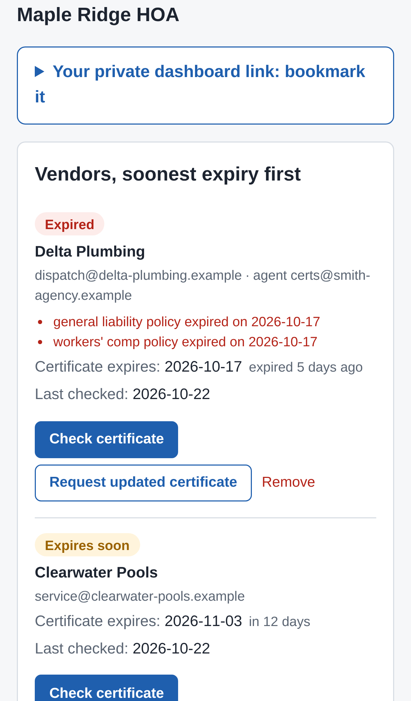

# covercheck — vendor insurance certificate checker for HOA boards

## Screenshots

Captured by `npm run screenshots` from the production build, with sample data only.

The landing page leads with the "Check a certificate free" call to action and a sample verdict produced by the real rules.

The same landing page fits an iPhone 13 screen, with the call to action above the fold.

A sample ACORD 25 PDF uploaded on `/check` is read and checked: the $500,000 limit and missing CG 20 37 fail with plain-English reasons, and workers' comp gets an "expires soon" warning.

The same verdict on a phone, one requirement per line.

The vendor dashboard lists vendors soonest expiry first, with status colours (Expired, Expires soon, OK, Not compliant), failed reasons and one-click actions.

On a phone, each vendor becomes a card with its status, reasons, expiry and actions.

For self-managed HOA and condo boards and small property managers, it checks each vendor's insurance certificate for the endorsement, name and expiry that actually protect the association, and nudges vendors before coverage lapses, at a board-sized price instead of $99+/month.

- [Research](RESEARCH.md) — findings and sources
- [PRD](PRD.md)
- [Roadmap](ROADMAP.md)
- [Build notes](BUILD.md): what's built, how to run, test and deploy it

Effort: Medium · Confidence: Low

_Researched by the idea pipeline on 2026-10-11 ([original record](https://github.com/smithdavedesign/idea-factory/tree/main/ideas/covercheck)); repo created on David's go-ahead 2026-10-11._
